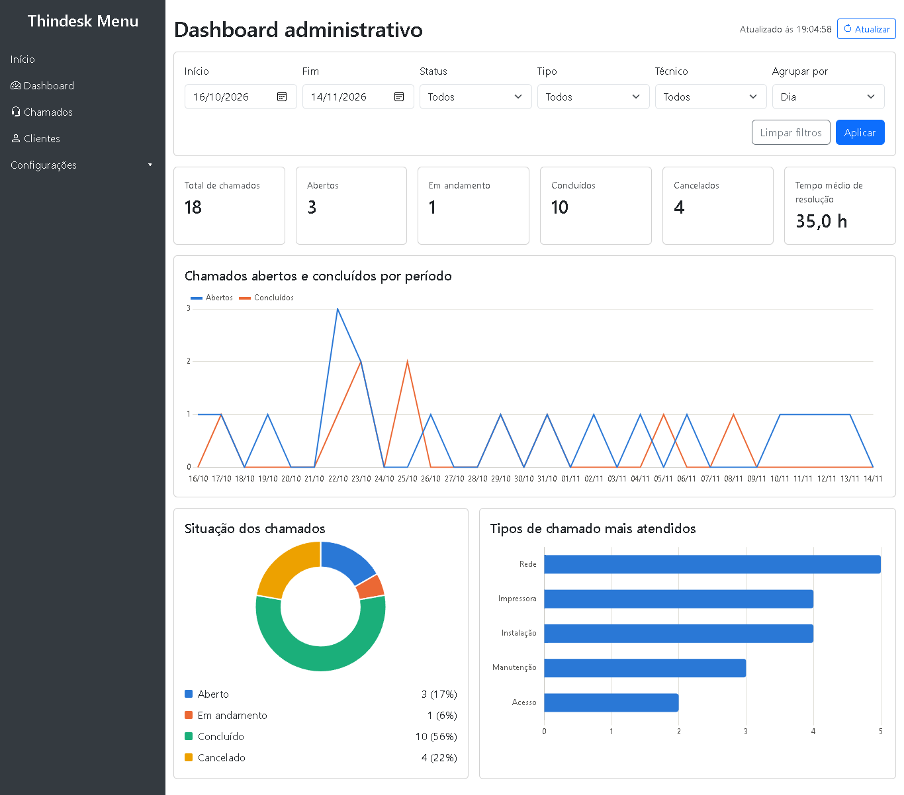
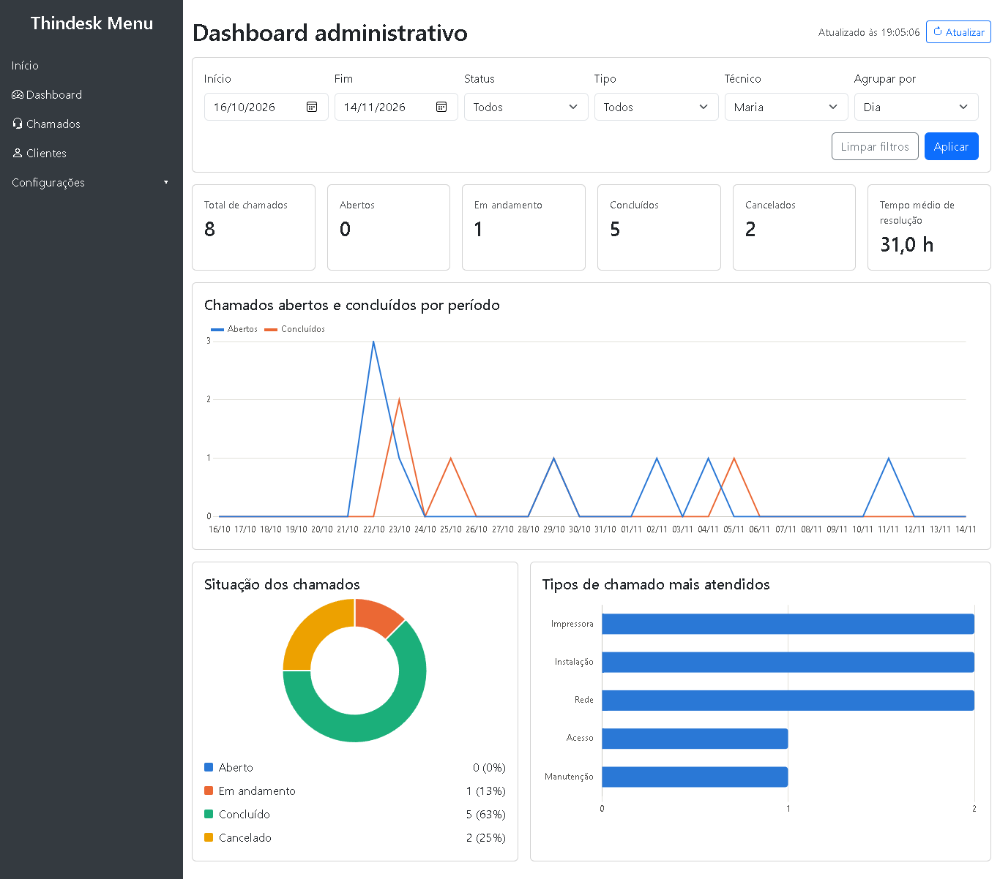
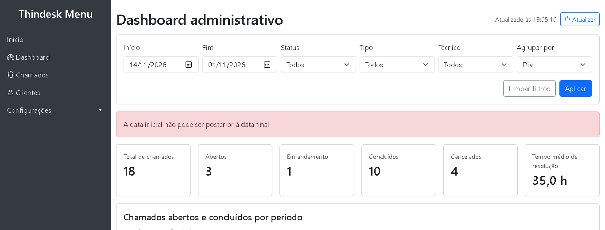
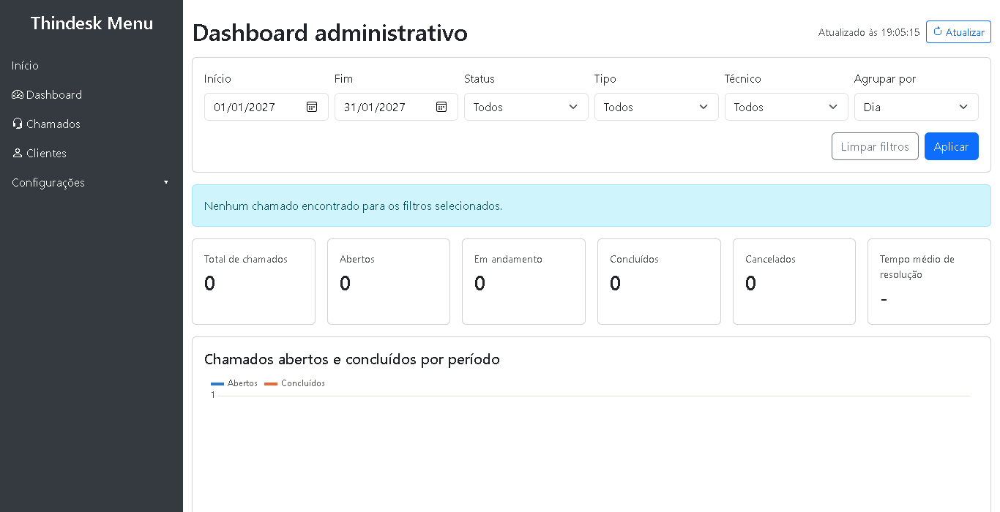
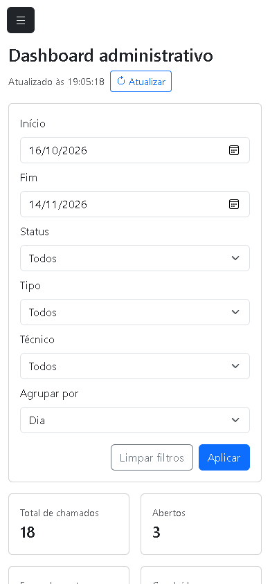

# Dashboard Thindesk

Dashboard administrativo integrado ao Thindesk, sistema web de controle de chamados técnicos. O painel consome dados de uma API REST própria, desenvolvida neste projeto, e apresenta indicadores, gráficos e filtros para acompanhar o andamento dos chamados e apoiar a tomada de decisão.

- **Aluno:** Jonathan Augusto Rodrigues Barbosa
- **Curso:** Bacharelado em Sistemas de Informação, Universidade de Mogi das Cruzes
- **Atividade:** Atividade prática M2
- **Professor:** Alessandro Aparecido da Silva Horas

## Sumário

- [Tecnologias](#tecnologias)
- [Requisitos funcionais](#requisitos-funcionais)
- [Requisitos não funcionais](#requisitos-não-funcionais)
- [Modelagem de dados](#modelagem-de-dados)
- [Documentação dos endpoints](#documentação-dos-endpoints)
- [Dashboard administrativo](#dashboard-administrativo)
- [Evidências de testes](#evidências-de-testes)
- [Como executar](#como-executar)
- [Referências](#referências)

## Tecnologias

| Tecnologia | Versão | Uso no projeto |
|---|---|---|
| Java | 23 (compilação), testado no 25 | Linguagem do back-end |
| Spring Boot (Web, Data MongoDB, Security, Thymeleaf) | 3.4.0 | Aplicação web, API REST, acesso ao banco e autenticação |
| MongoDB | Atlas (nuvem) e 8.2 (local, para testes) | Banco de dados dos chamados |
| Chart.js | 4.4.1 | Gráficos do dashboard |
| Bootstrap | 5.3.0 | Layout e componentes visuais |
| JUnit 5, Mockito e Spring Test | Incluídos no Spring Boot 3.4.0 | Testes automatizados |
| Maven | 3.9.9 (wrapper) | Compilação e dependências |
| Git e GitHub | - | Versionamento com Git flow |

## Requisitos funcionais

| Código | Requisito | Como foi atendido |
|---|---|---|
| RF01 | Indicadores gerais de chamados técnicos | Cards com total de chamados, abertos, em andamento, concluídos, cancelados e tempo médio de resolução, fornecidos pelo endpoint `/indicadores`. |
| RF02 | Análise de chamados atendidos por período (gráficos) | Gráfico de linhas com os chamados abertos e concluídos por dia ou por mês, fornecido pelo endpoint `/periodo`. |
| RF03 | Situação dos chamados | Gráfico de rosca com a quantidade e o percentual de cada status, fornecido pelo endpoint `/status`. |
| RF04 | Tipos de chamados mais atendidos | Gráfico de barras com o ranking dos tipos, do mais frequente para o menos frequente, fornecido pelo endpoint `/tipos`. |
| RF05 | Filtros de consulta | Filtros de data inicial, data final, status, tipo e técnico, aplicados a todos os indicadores e gráficos. As opções vêm do endpoint `/filtros`. |
| RF06 | Integração com a API | A página do dashboard obtém todos os dados por requisições HTTP aos endpoints de `/api/dashboard` e recebe as respostas em JSON. |
| RF07 | Atualização e tratamento de dados | Atualização manual (botão Atualizar) e automática a cada 60 segundos; validação dos parâmetros com mensagens de erro; padronização de status gravados de formas diferentes; campos vazios exibidos como "Não informado"; datas de abertura e conclusão preenchidas pelo servidor. |

## Requisitos não funcionais

| Código | Categoria | Requisito |
|---|---|---|
| RNF01 | Segurança | O dashboard e a API só podem ser acessados por usuário autenticado. Sem sessão, a requisição é redirecionada para a página de login. |
| RNF02 | Configuração | A conexão com o banco de dados é informada pela variável de ambiente `THINDESK_MONGODB_URI`, sem credenciais gravadas no código-fonte. |
| RNF03 | Interoperabilidade | A API segue o estilo REST, usa o método GET para as consultas e responde em JSON, com datas no formato ISO 8601 (AAAA-MM-DD). |
| RNF04 | Confiabilidade | Parâmetros inválidos são rejeitados com o código HTTP 400 e uma mensagem padronizada, sem interromper o funcionamento do painel. |
| RNF05 | Usabilidade | A interface é responsiva e pode ser usada em computadores e em telas de celular. |
| RNF06 | Acessibilidade | As cores dos gráficos foram verificadas quanto à distinção para pessoas com daltonismo, e a legenda do gráfico de situação mostra os valores por escrito, sem depender apenas da cor. |
| RNF07 | Desempenho | O campo de data de abertura possui índice no banco, usado nas consultas por período, e a atualização automática é suspensa quando a aba do navegador não está visível. |
| RNF08 | Manutenibilidade | O código segue a separação em camadas (controller, service e repository) e possui testes automatizados para o serviço e para a API. |
| RNF09 | Portabilidade | A aplicação requer Java 23 ou superior (validada com Java 25), e a interface foi testada no navegador Microsoft Edge. |

## Modelagem de dados

O chamado é armazenado como documento na coleção `chamados` do MongoDB. Para permitir a análise por período e o cálculo do tempo de resolução, a entidade `Chamado` recebeu dois campos de data, e o status, que antes era um texto livre, passou a ser uma enumeração com valores fixos.

| Campo | Tipo | Descrição |
|---|---|---|
| `id` | String (ObjectId) | Identificador gerado pelo MongoDB |
| `descricao` | String | Descrição do problema |
| `status` | StatusChamado | Situação do chamado |
| `tipo` | String | Tipo do chamado, por exemplo Rede ou Impressora |
| `tecnico` | String | Técnico responsável |
| `usuario` | String | Usuário que abriu o chamado |
| `dataAbertura` | LocalDateTime (com índice) | Data e hora de abertura, preenchida pelo servidor na criação do chamado |
| `dataConclusao` | LocalDateTime | Data e hora de conclusão, preenchida quando o status muda para CONCLUIDO e apagada se o chamado for reaberto |

| Valor do status | Descrição exibida |
|---|---|
| `ABERTO` | Aberto |
| `EM_ANDAMENTO` | Em andamento |
| `CONCLUIDO` | Concluído |
| `CANCELADO` | Cancelado |

Documentos antigos que tenham o status gravado de outra forma, como "Em Andamento" ou "Concluído", são convertidos para o valor correspondente da enumeração no momento da leitura. Os campos tipo e técnico continuam como texto livre e, quando estão vazios, a API os apresenta como "Não informado".

## Documentação dos endpoints

A API do dashboard fica no caminho `/api/dashboard` da própria aplicação, por exemplo `http://localhost:8080/api/dashboard` ao executar localmente. Todos os endpoints usam o método GET, retornam JSON e exigem que o usuário esteja autenticado. A autenticação é feita pela página de login, e a sessão é mantida pelo navegador.

| Método | Endpoint | Descrição | RF |
|---|---|---|---|
| GET | `/api/dashboard/indicadores` | Indicadores gerais | RF01 |
| GET | `/api/dashboard/periodo` | Abertos e concluídos por período | RF02 |
| GET | `/api/dashboard/status` | Quantidade por status | RF03 |
| GET | `/api/dashboard/tipos` | Ranking dos tipos de chamado | RF04 |
| GET | `/api/dashboard/filtros` | Opções para os filtros | RF05 |

Os endpoints de indicadores, período, status e tipos aceitam os mesmos parâmetros de filtro, todos opcionais e informados na URL. O filtro de datas considera a data de abertura do chamado. Quando nenhum filtro é informado, todos os chamados cadastrados são considerados.

| Parâmetro | Tipo | Obrigatório | Descrição |
|---|---|---|---|
| `inicio` | Data (AAAA-MM-DD) | Não | Data inicial do período, inclusive |
| `fim` | Data (AAAA-MM-DD) | Não | Data final do período, inclusive |
| `status` | Texto | Não | ABERTO, EM_ANDAMENTO, CONCLUIDO ou CANCELADO |
| `tipo` | Texto | Não | Tipo do chamado, como retornado por `/filtros` |
| `tecnico` | Texto | Não | Nome do técnico, como retornado por `/filtros` |

### GET /api/dashboard/indicadores

Retorna a quantidade total de chamados, a quantidade em cada status e o tempo médio de resolução, em horas, calculado entre a abertura e a conclusão dos chamados concluídos. Quando não há chamado concluído no filtro, o tempo médio é retornado como `null`.

Parâmetros: filtros comuns.

```http
GET /api/dashboard/indicadores?inicio=2026-10-16&fim=2026-11-14
```

Resposta `200 OK`:

```json
{
  "total": 18,
  "abertos": 3,
  "emAndamento": 1,
  "concluidos": 10,
  "cancelados": 4,
  "tempoMedioResolucaoHoras": 35.0
}
```

Exemplo com filtros de status e técnico:

```http
GET /api/dashboard/indicadores?inicio=2026-10-16&fim=2026-11-14&status=CONCLUIDO&tecnico=Maria
```

```json
{
  "total": 5,
  "abertos": 0,
  "emAndamento": 0,
  "concluidos": 5,
  "cancelados": 0,
  "tempoMedioResolucaoHoras": 31.0
}
```

### GET /api/dashboard/periodo

Retorna, para cada dia ou mês do período, a quantidade de chamados abertos (pela data de abertura) e concluídos (pela data de conclusão). Os períodos sem chamados aparecem com valor zero. Sem data inicial, a série começa no primeiro chamado registrado; sem data final, termina no dia atual.

Parâmetros: filtros comuns e mais o parâmetro abaixo.

| Parâmetro | Tipo | Obrigatório | Descrição |
|---|---|---|---|
| `agrupamento` | Texto | Não | `DIA` (padrão) ou `MES`. Por dia, o campo `periodo` vem como AAAA-MM-DD; por mês, como AAAA-MM. |

```http
GET /api/dashboard/periodo?inicio=2026-11-10&fim=2026-11-14&agrupamento=DIA
```

Resposta `200 OK`:

```json
[
  { "periodo": "2026-11-10", "abertos": 1, "concluidos": 0 },
  { "periodo": "2026-11-11", "abertos": 1, "concluidos": 0 },
  { "periodo": "2026-11-12", "abertos": 1, "concluidos": 0 },
  { "periodo": "2026-11-13", "abertos": 1, "concluidos": 0 },
  { "periodo": "2026-11-14", "abertos": 0, "concluidos": 0 }
]
```

Exemplo com agrupamento por mês:

```http
GET /api/dashboard/periodo?inicio=2026-10-16&fim=2026-11-14&agrupamento=MES
```

```json
[
  { "periodo": "2026-10", "abertos": 11, "concluidos": 8 },
  { "periodo": "2026-11", "abertos": 7, "concluidos": 2 }
]
```

### GET /api/dashboard/status

Retorna a quantidade de chamados em cada status, sempre na ordem Aberto, Em andamento, Concluído e Cancelado, inclusive os que têm quantidade zero. Chamados sem status aparecem em um item adicional "Não informado".

Parâmetros: filtros comuns.

```http
GET /api/dashboard/status?inicio=2026-10-16&fim=2026-11-14
```

Resposta `200 OK`:

```json
[
  { "rotulo": "Aberto", "quantidade": 3 },
  { "rotulo": "Em andamento", "quantidade": 1 },
  { "rotulo": "Concluído", "quantidade": 10 },
  { "rotulo": "Cancelado", "quantidade": 4 }
]
```

### GET /api/dashboard/tipos

Retorna os tipos de chamado ordenados da maior para a menor quantidade e, em caso de empate, em ordem alfabética. Tipos vazios são agrupados como "Não informado".

Parâmetros: filtros comuns e mais o parâmetro abaixo.

| Parâmetro | Tipo | Obrigatório | Descrição |
|---|---|---|---|
| `limite` | Inteiro | Não | Quantidade máxima de tipos retornados. Padrão 5, mínimo 1. |

```http
GET /api/dashboard/tipos?inicio=2026-10-16&fim=2026-11-14&limite=3
```

Resposta `200 OK`:

```json
[
  { "rotulo": "Rede", "quantidade": 5 },
  { "rotulo": "Impressora", "quantidade": 4 },
  { "rotulo": "Instalação", "quantidade": 4 }
]
```

### GET /api/dashboard/filtros

Retorna as opções disponíveis para os filtros: os status possíveis, com valor e rótulo, e os tipos e técnicos existentes nos chamados, sem repetição e em ordem alfabética. Não recebe parâmetros.

```http
GET /api/dashboard/filtros
```

Resposta `200 OK`:

```json
{
  "status": [
    { "valor": "ABERTO", "rotulo": "Aberto" },
    { "valor": "EM_ANDAMENTO", "rotulo": "Em andamento" },
    { "valor": "CONCLUIDO", "rotulo": "Concluído" },
    { "valor": "CANCELADO", "rotulo": "Cancelado" }
  ],
  "tipos": ["Acesso", "Impressora", "Instalação", "Manutenção", "Rede"],
  "tecnicos": ["Carlos", "João", "Maria"]
}
```

### Possíveis erros

Os erros de validação retornam o código HTTP 400 com um corpo JSON no formato abaixo, em que o campo `mensagem` descreve o problema.

```json
{
  "status": 400,
  "mensagem": "A data inicial não pode ser posterior à data final"
}
```

| Situação | Exemplo | HTTP | Mensagem retornada |
|---|---|---|---|
| Data inicial posterior à data final | `inicio=2026-11-14&fim=2026-11-01` | 400 | A data inicial não pode ser posterior à data final |
| Status inexistente | `status=XYZ` | 400 | Valor inválido para: status |
| Agrupamento inexistente | `agrupamento=ANO` | 400 | Valor inválido para: agrupamento |
| Limite menor que 1 | `limite=0` | 400 | O limite deve ser maior que zero |
| Limite não numérico | `limite=abc` | 400 | Valor inválido para: limite |
| Data em formato inválido | `inicio=2026-13-01` | 400 | Valor inválido para: inicio |
| Usuário não autenticado | Requisição sem sessão | 302 | Redirecionamento para `/login` |

## Dashboard administrativo

O dashboard é acessado pelo item Dashboard do menu lateral do Thindesk, no endereço `/dashboard`, após o login. A página é composta por:

- barra de filtros com data inicial, data final, status, tipo, técnico e agrupamento, que abre com os últimos 30 dias;
- seis cards de indicadores (RF01);
- gráfico de linhas com os chamados abertos e concluídos por período (RF02);
- gráfico de rosca com a situação dos chamados e legenda com quantidade e percentual (RF03);
- gráfico de barras com os tipos de chamado mais atendidos (RF04).

Ao abrir a página e a cada atualização, o JavaScript do dashboard faz requisições paralelas aos endpoints da API com os filtros selecionados e redesenha os cards e os gráficos com as respostas. O botão Atualizar recarrega os dados na hora, e a página também se atualiza sozinha a cada 60 segundos, exibindo o horário da última atualização. Se a API retornar um erro, a mensagem é exibida acima dos indicadores; se o filtro não encontrar chamados, o painel informa que não há resultados.



*Figura 1 - Dashboard administrativo com o período padrão de 30 dias*

## Evidências de testes

Foram feitos três tipos de teste: testes automatizados, testes manuais da API e testes da interface do dashboard. Os testes manuais foram executados com a aplicação ligada a um banco de dados de teste, carregado com os 60 chamados de exemplo do perfil `dev`.

### Testes automatizados

Os testes foram escritos com JUnit 5 e Mockito. A classe `DashboardServiceTest` testa as regras de cálculo do serviço sem acessar o banco de dados, simulando o `MongoTemplate` e fixando a data atual. A classe `DashboardControllerTest` testa os endpoints com o MockMvc, usando a configuração de segurança real da aplicação.

```bash
./mvnw test
```

```text
[INFO] Tests run: 6, Failures: 0, Errors: 0, Skipped: 0, Time elapsed: 2.823 s -- in com.pfc.thindesk.controller.DashboardControllerTest
[INFO] Tests run: 11, Failures: 0, Errors: 0, Skipped: 0, Time elapsed: 0.402 s -- in com.pfc.thindesk.service.DashboardServiceTest
[INFO] Tests run: 17, Failures: 0, Errors: 0, Skipped: 0
[INFO] BUILD SUCCESS
```

| Teste (DashboardServiceTest) | O que verifica | Resultado |
|---|---|---|
| `deveCalcularIndicadoresPorStatusETempoMedioDeResolucao` | Contagem por status e média de 3,0 h entre chamados resolvidos em 2 h e 4 h | Aprovado |
| `deveRetornarTempoMedioNuloQuandoNaoHaChamadosConcluidos` | Tempo médio nulo quando não há chamado concluído | Aprovado |
| `deveAplicarFiltrosDeStatusTipoETecnico` | Filtros de status, tipo e técnico aplicados em conjunto | Aprovado |
| `deveConsultarChamadosPelaDataDeAberturaDoPeriodo` | Consulta com data de abertura maior ou igual ao início e menor que o dia seguinte ao fim | Aprovado |
| `deveRecusarDataInicialPosteriorADataFinal` | Erro de validação sem consultar o banco | Aprovado |
| `deveMontarSerieDiariaIncluindoDiasSemChamados` | Dias sem chamados aparecem com valor zero | Aprovado |
| `deveAgruparSeriePorMesDaPrimeiraAberturaAteHoje` | Série mensal do primeiro chamado até o mês atual | Aprovado |
| `deveListarTodosOsStatusEContarChamadosSemStatusComoNaoInformado` | Quatro status e o item "Não informado" | Aprovado |
| `deveOrdenarTiposPelaQuantidadeELimitarOResultado` | Ordenação, junção de textos com espaços, "Não informado" e limite | Aprovado |
| `deveRecusarLimiteMenorQueUm` | Erro de validação para limite igual a zero | Aprovado |
| `deveListarOpcoesDeFiltroSemRepeticaoEEmOrdemAlfabetica` | Tipos e técnicos sem repetição e em ordem alfabética | Aprovado |

| Teste (DashboardControllerTest) | O que verifica | Resultado |
|---|---|---|
| `deveRetornarIndicadoresUsandoOsFiltrosRecebidos` | Os parâmetros da URL chegam ao serviço e a resposta sai em JSON | Aprovado |
| `deveAgruparPorDiaQuandoOAgrupamentoNaoForInformado` | Agrupamento padrão por dia | Aprovado |
| `deveRetornarErroQuandoOStatusForInvalido` | HTTP 400 com a mensagem "Valor inválido para: status" | Aprovado |
| `deveRetornarErroQuandoOAgrupamentoForInvalido` | HTTP 400 com a mensagem "Valor inválido para: agrupamento" | Aprovado |
| `deveRetornarAMensagemDoServicoQuandoUmParametroForRecusado` | HTTP 400 com a mensagem gerada pelo serviço | Aprovado |
| `deveRedirecionarParaOLoginQuandoNaoHouverUsuarioAutenticado` | Redirecionamento para `/login` sem usuário autenticado | Aprovado |

### Testes manuais da API

Com a aplicação em execução, cada endpoint foi chamado com e sem filtros e com parâmetros inválidos. As respostas obtidas são as mesmas apresentadas como exemplos na [documentação dos endpoints](#documentação-dos-endpoints).

| Requisição | Resultado esperado | Resultado obtido |
|---|---|---|
| `/indicadores?inicio=2026-10-16&fim=2026-11-14` | Indicadores do período | 200: 18 chamados (3 abertos, 1 em andamento, 10 concluídos, 4 cancelados), tempo médio de 35,0 h |
| `/indicadores?inicio=2026-10-16&fim=2026-11-14&status=CONCLUIDO&tecnico=Maria` | Apenas chamados concluídos do técnico Maria | 200: 5 chamados, tempo médio de 31,0 h |
| `/periodo?inicio=2026-11-10&fim=2026-11-14&agrupamento=DIA` | Um item por dia, inclusive dias sem chamados | 200: 5 dias, com 14/11 zerado |
| `/periodo?inicio=2026-10-16&fim=2026-11-14&agrupamento=MES` | Um item por mês | 200: outubro com 11 abertos e 8 concluídos; novembro com 7 e 2 |
| `/status?inicio=2026-10-16&fim=2026-11-14` | Os quatro status | 200: Aberto 3, Em andamento 1, Concluído 10, Cancelado 4 |
| `/tipos?inicio=2026-10-16&fim=2026-11-14&limite=3` | Os três tipos mais frequentes | 200: Rede 5, Impressora 4, Instalação 4 |
| `/filtros` | Status, tipos e técnicos | 200: 4 status, 5 tipos e 3 técnicos |
| `/indicadores?inicio=2026-11-14&fim=2026-11-01` | Erro de validação | 400: A data inicial não pode ser posterior à data final |
| `/status?status=XYZ` | Erro de validação | 400: Valor inválido para: status |
| `/periodo?agrupamento=ANO` | Erro de validação | 400: Valor inválido para: agrupamento |
| `/tipos?limite=0` | Erro de validação | 400: O limite deve ser maior que zero |
| `/tipos?limite=abc` | Erro de validação | 400: Valor inválido para: limite |
| `/indicadores?inicio=2026-13-01` | Erro de validação | 400: Valor inválido para: inicio |
| `/indicadores` sem login | Redirecionamento para o login | 302 para `/login` |

### Testes da interface

A interface foi testada no navegador Microsoft Edge com o mesmo banco de teste. Com o filtro pelo técnico Maria, os indicadores e os três gráficos passam a considerar apenas os chamados desse técnico, e os valores de concluídos e de tempo médio (5 chamados e 31,0 h) coincidem com os retornados pela API no teste com status CONCLUIDO e técnico Maria.



*Figura 2 - Dashboard filtrado pelo técnico Maria*

Ao informar uma data inicial posterior à data final, a API retorna erro 400 e o painel exibe a mensagem recebida, mantendo os dados da consulta anterior.



*Figura 3 - Mensagem de erro de validação retornada pela API*

Quando o filtro não encontra chamados, os indicadores ficam zerados e o painel informa que não há resultados.



*Figura 4 - Dashboard sem chamados para o período filtrado*

Em telas de celular, os filtros e os cards são reorganizados em uma coluna e o menu lateral fica recolhido em um botão. Também foi verificado que o botão Limpar filtros restaura o período padrão de 30 dias e que nenhum erro de JavaScript foi registrado no console do navegador.



*Figura 5 - Dashboard em tela de celular*

### Relação entre requisitos e evidências

| Requisito | Evidências |
|---|---|
| RF01 | Figura 1; teste de cálculo dos indicadores; requisições ao endpoint `/indicadores` |
| RF02 | Figuras 1 e 2; testes das séries diária e mensal; requisições ao endpoint `/periodo` |
| RF03 | Figuras 1 e 2; teste da lista de status; requisição ao endpoint `/status` |
| RF04 | Figuras 1 e 2; teste de ordenação dos tipos; requisição ao endpoint `/tipos` |
| RF05 | Figura 2; teste de aplicação dos filtros; requisições com status e técnico |
| RF06 | Figuras 1 a 5; testes do controller da API; requisições manuais à API |
| RF07 | Figuras 3 e 4; testes de validação; requisições com resposta 400 |

## Como executar

Pré-requisitos: Java 23 ou superior e acesso a um banco MongoDB, local ou no MongoDB Atlas.

1. Configure a variável de ambiente `THINDESK_MONGODB_URI` com a string de conexão do banco. Sem essa variável, a aplicação usa o MongoDB local em `mongodb://localhost:27017`.
2. Na pasta do projeto, execute o comando abaixo. O perfil `dev` cadastra 60 chamados de exemplo quando a coleção de chamados está vazia.

   ```bash
   ./mvnw spring-boot:run "-Dspring-boot.run.profiles=dev"
   ```

3. Acesse `http://localhost:8080`, entre com o usuário `admin` e a senha `thindesk` e abra o item Dashboard do menu.

Para executar os testes automatizados:

```bash
./mvnw test
```

## Referências

- BOOTSTRAP. **Bootstrap 5.3 documentation**. Disponível em: https://getbootstrap.com/docs/5.3/. Acesso em: 14 nov. 2026.
- CHART.JS. **Chart.js documentation**. Disponível em: https://www.chartjs.org/docs/latest/. Acesso em: 14 nov. 2026.
- FIELDING, Roy Thomas. **Architectural styles and the design of network-based software architectures**. 2000. Tese (Doutorado em Information and Computer Science) - University of California, Irvine, 2000.
- MONGODB. **MongoDB documentation**. Disponível em: https://www.mongodb.com/docs/manual/. Acesso em: 14 nov. 2026.
- SPRING. **Spring Boot reference documentation**. Disponível em: https://docs.spring.io/spring-boot/. Acesso em: 14 nov. 2026.
